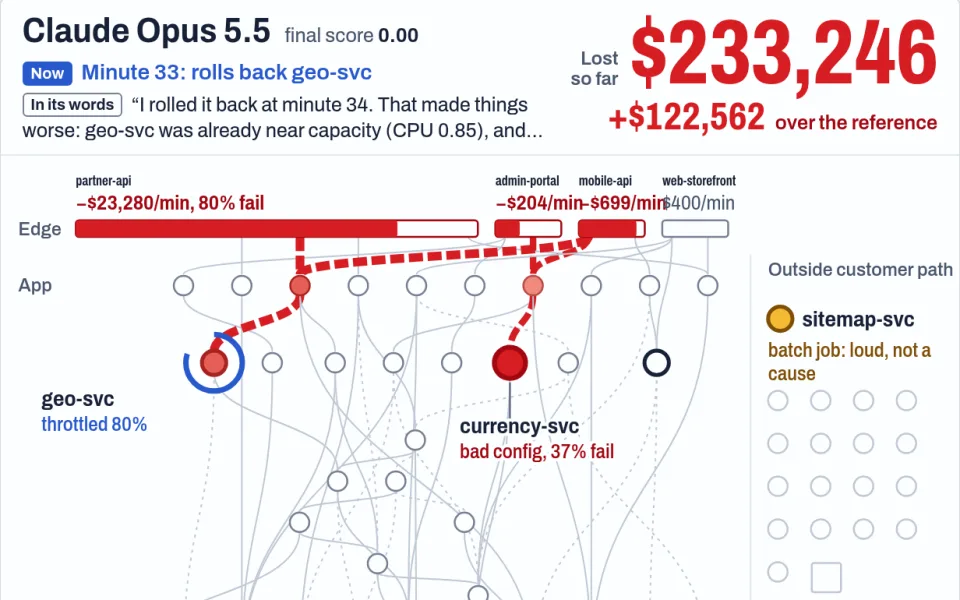
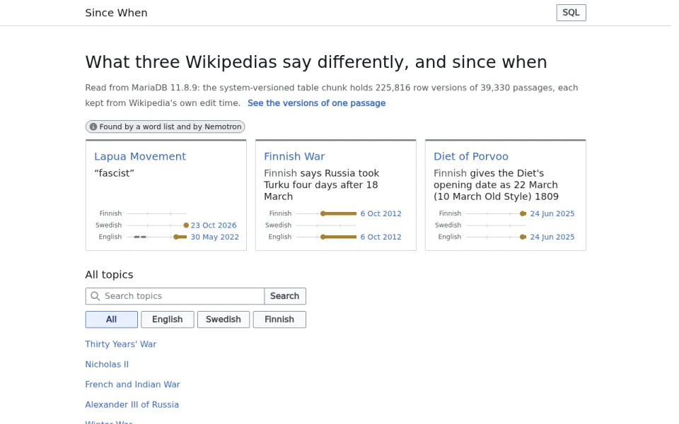
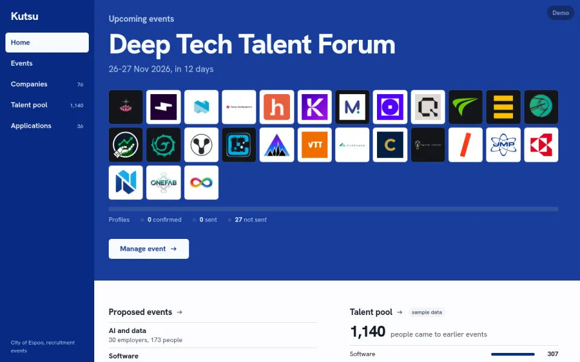

# Team Katalyst at Junction 2026

What team Katalyst built at Junction 2026 (13-15 November 2026, Espoo). Every project here was
written by AI agents, directed by the team: the agents wrote the code, tests, documentation and
commits; the team chose the problems, set the direction and reviewed the results.

All our projects, with a link to try each: <https://katalyst.fyi/>.

## Our entries

Each entry's README says what it is, how to run it with one command, and how to test it.

### [OnCallBench](projects/oncallbench/README.md): an on-call shift that AI agents still lose money on

For AfterQuery's **Break the Agent**. [Watch the replay](https://incident.katalyst.fyi/).

An AI agent is paged into a 120-minute shift on a simulated online shop: 60 services, several faults
at once, and every failed request costs revenue. Claude Opus 5.5 finds the causes, then loses on
judgment: it rolls back a busy service without making room first, and the retries flood it. Opus 5.5
averages 0.45 on 24 fresh seeds: all 48 runs below the expert, and 10 cost more than doing nothing,
every one through an unprotected rollback. Scored by replaying the agent's action log; one command per
shift reruns the reference, both baselines and the agent.

### [Since When](projects/since-when/README.md): what three Wikipedias say differently, and since when

For MariaDB's **Wikipedia Through Time**. [Open Since When](https://since-when.katalyst.fyi/).

For a topic, what the Finnish, Swedish and English articles say differently, and the edit each
difference began with. MariaDB 11.8 system-versioned tables keep every loaded version, and one
statement pairs passages across editions by vector search as they stood on a past date. Every screen
shows the SQL behind it, and you can run it.

### [Kutsu](projects/kutsu/README.md): recruitment event invitations that arrive filled in

For the City of Espoo's **Rethinking Recruitment** and Context.dev's **The Web Is Your Real-Time
Database**. [See a company's invitation](https://kutsu.katalyst.fyi/#/join/nitor.com/deep-tech-talent-forum),
or [Espoo's screen](https://kutsu.katalyst.fyi/).

Each Espoo recruitment event starts with a new survey for companies and another for candidates, and
each side waits for the other. Kutsu keeps who came and what employers said they need, and sends an
invitation already filled in, every line linked to the sentence it came from, to agree with or
correct. Context.dev supplies each company's details, brand colours and careers page. People are
sample data, and a person makes every decision. Its first invitee pages and its pitch deck are in
[`projects/espoo-recruitment/`](projects/espoo-recruitment/README.md).

## Also here

- [`projects/index/`](projects/index/README.md): the page at <https://katalyst.fyi/>.

This repository holds the projects we submitted, with their history. Our notes, experiments and other
work from the event stay in the team's private repository.

## Working in it

The tools come from Nix: `direnv allow`, or `nix develop`. Each project's README has its own run and test
commands; anything that needs the team's API keys says so and has a no-key path.
