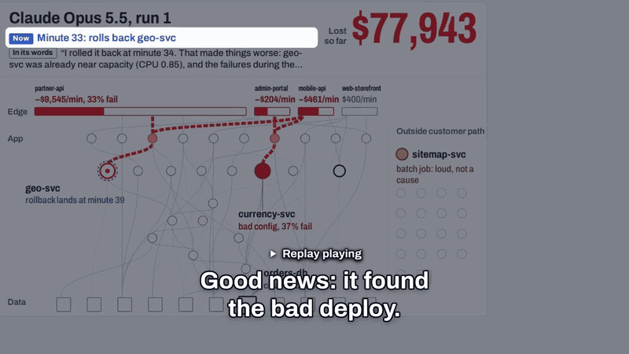
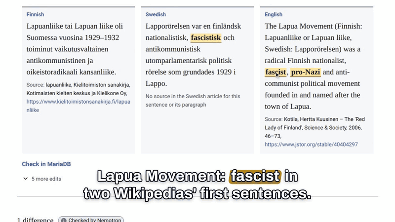
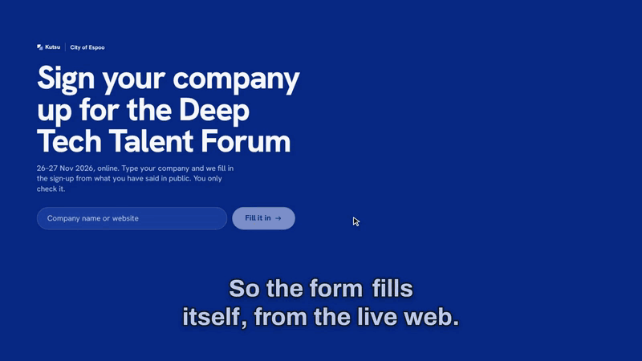

# Team Katalyst at Junction 2026

What team Katalyst built at Junction 2026 (13-15 November 2026, Espoo): three entries, each of which ran
live through the event.

All the videos: [one release page](https://github.com/KatalystSoftware/junction-2026/releases/tag/videos).
The live demos at katalyst.fyi ran on the event's temporary machines and accounts, which were removed when
it ended on 15 November. To try an entry now, run it yourself.

## Our entries

Each entry's README says what it is, how to run it with one command, and how to test it.

###  [OnCallBench](projects/oncallbench/README.md): an on-call shift that AI agents still lose money on

For AfterQuery's **Break the Agent**. ▶ [Video, 1:24 (mp4, 74 MB)](https://github.com/KatalystSoftware/junction-2026/releases/download/videos/oncallbench.mp4) · [Source and how to run it](projects/oncallbench/README.md)

- **Problem:** AI agents are being put on call, and nobody sees how they fail until they fail on a live system.
- **What it is:** a two-hour on-call shift at a simulated online shop, scored on the money lost: 1.00 is our scripted expert, 0.00 is doing nothing.
- **Result:** Claude Opus 5.5 averages **0.45**. All 48 runs lose to the expert; 10 cost more than doing nothing, each through a rollback without adding capacity first.
- **Trained:** Gemma 4, post-trained by us on other seeds, goes from 0.05 to **0.44**, [statistically level with Opus](projects/oncallbench/README.md#a-smaller-model-learns-from-it).

###  [Since When](projects/since-when/README.md): what three Wikipedias say differently, and since when

For MariaDB's **Wikipedia Through Time**. ▶ [Video, 1:16 (mp4, 58 MB)](https://github.com/KatalystSoftware/junction-2026/releases/download/videos/since-when.mp4) · [Source and how to run it](projects/since-when/README.md)

- **Hook:** Swedish Wikipedia began calling the Lapua Movement “fascist” on 23 October 2026, English in 2022; Finnish still doesn't.
- **What it is:** for a topic, what the Finnish, Swedish and English articles say differently, and the edit each difference began with.
- **How:** MariaDB 11.8 system-versioned tables plus vector search pair passages as they stood on any past date, in one SQL statement you can run on every screen.

###  [Kutsu](projects/kutsu/README.md): recruitment event invitations that arrive filled in

For the City of Espoo's **Rethinking Recruitment** and Context.dev's **The Web Is Your Real-Time
Database**.
▶ Videos: [for Espoo, 0:41 (mp4, 4 MB)](https://github.com/KatalystSoftware/junction-2026/releases/download/videos/kutsu-espoo.mp4) · [for Context.dev, 0:43 (mp4, 28 MB)](https://github.com/KatalystSoftware/junction-2026/releases/download/videos/kutsu-context-dev.mp4) · [Source and how to run it](projects/kutsu/README.md)

- **Problem:** every Espoo recruitment event starts with new surveys, and organisers learn late whom companies want to hire.
- **What it is:** an invitation that arrives filled in from the live web via Context.dev, every line linked to its source, for the company to confirm or correct.
- **Live:** Context.dev monitors on 74 employers tell Espoo what changed. People are sample data; a person makes every decision.

## What we built on

| Partner tech | What it does here | Entry |
| --- | --- | --- |
| **Verda** | The server behind every live demo and the agent evaluations; GPUs rented through the API to train Gemma and Qwen; the container serving Nemotron. Machines defined with Verda's official OpenTofu provider ([how we used Verda](infra/verda/README.md)) | All |
| **Gemma** | Gemma 4 26B-A4B, post-trained by us on OnCallBench: 0.05 → 0.44, level with Opus 5.5 | OnCallBench |
| **Modal** | Gemma's evaluations, audit and RL on H200s; the post-trained Gemma served live from Modal | OnCallBench |
| **Gemini** | Gemini 3.1 Pro, one of the two frontier models each level was made harder against | OnCallBench |
| **NVIDIA Nemotron** | Nemotron 3.5 Super VL names what each pair of passages says differently, then checks every claim against the whole other article | Since When |
| **MariaDB** | 11.8 system-versioned tables and vector search: the nearest passage in another edition, as both stood on a past date, in one statement | Since When |
| **Context.dev** | Brand search and retrieve fill in each company's sign-up; web scrape reads careers pages; 116 monitors watch 74 employers | Kutsu |
| **OpenAI Codex** | Fresh GPT 6.1 Sol reviewers checked each round of the environment and of the page | OnCallBench, Since When |
| **CRACI** | Our CI runs on CRACI runners, including a job that downloads, verifies and runs the published Gemma adapter | All |

## Also here

- [`projects/index/`](projects/index/README.md): the page that was at katalyst.fyi.
- [`infra/verda/`](infra/verda/main.tf): the Verda machines the demos and evaluations ran on, defined
  with Verda's official OpenTofu provider, and the [proxy](infra/verda/proxy/README.md) every demo
  sat behind; [how we used Verda](infra/verda/README.md).

This repository holds the projects we submitted, with their history. Our notes, experiments and other
work from the event stay in the team's private repository.

## Working in it

The tools come from Nix: `direnv allow`, or `nix develop`. Each project's README has its own run and test
commands; anything that needs the team's API keys says so and has a no-key path.
